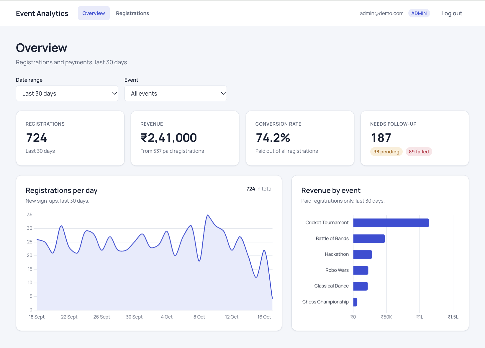
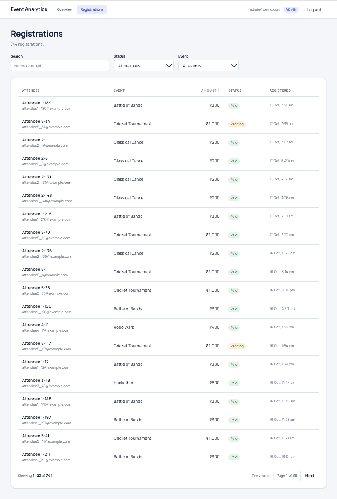
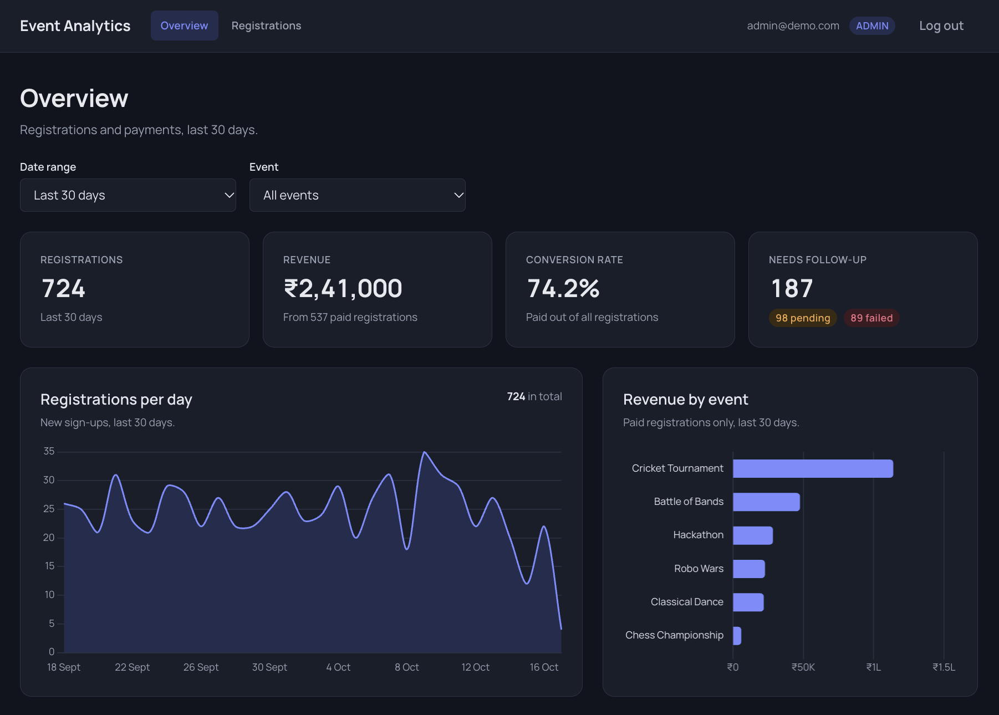
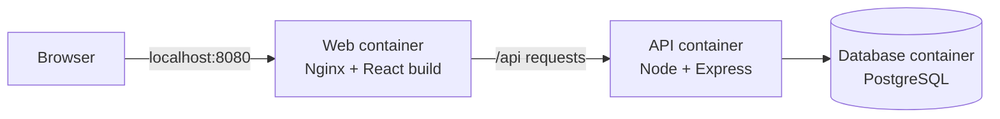

# Event Analytics Dashboard

A full-stack analytics dashboard for event registrations and payments. Admins and viewers sign in to see registrations, revenue and payment status over time, filter by date range and event, and (admins only) browse every registration with search, sorting and pagination.

Built with **React + TypeScript** on the front end, **Node.js + Express + PostgreSQL** on the back end, and packaged with **Docker**.



---

## Features

**Dashboard**
- KPI cards: total registrations, revenue, conversion rate, and payments needing follow-up
- Daily registrations line chart, with gaps filled for days that had no sign-ups
- Revenue-by-event bar chart (admins only), highlighting the selected event
- Filters for date range (7, 30 or 90 days) and event, stored in the URL so a view can be refreshed or shared
- Loading skeletons, empty states and error states with retry on every card and chart

**Registrations (admins only)**
- Table of every registration with status badges
- Debounced search by attendee name or email
- Filter by payment status and event
- Sortable columns and server-side pagination

**Access and security**
- Login with JWTs stored in HttpOnly cookies
- Two roles: `ADMIN` and `VIEWER`, enforced on the server for every protected endpoint
- Input validation with Zod on every request

**General**
- Light and dark mode, following the operating system setting
- Works on phone, tablet and desktop widths

| Registrations | Dark mode |
|---|---|
|  |  |

---

## Tech stack

| Area | Tools |
|---|---|
| Frontend | React 19, TypeScript (strict), Vite, React Router, Chart.js, CSS Modules with design tokens |
| Backend | Node.js, Express 5, TypeScript (strict), Zod, JSON Web Tokens, bcrypt |
| Database | PostgreSQL 16, Prisma (schema and migrations), raw SQL for analytics queries |
| Testing | Vitest, Supertest, React Testing Library |
| Infrastructure | Docker (multi-stage builds), Docker Compose, Nginx |

---

## Architecture



- The browser only talks to Nginx. Nginx serves the React app and forwards anything under `/api` to the API, so the app has a single origin and login cookies work without CORS configuration.
- Only the web container is reachable from outside. The API and database are on a private Docker network.
- Database migrations run as a separate one-off job that must succeed before the API starts.

---

## Getting started

### Option 1: Run everything with Docker (recommended)

Requires [Docker Desktop](https://www.docker.com/products/docker-desktop/).

```bash
# 1. Create your settings file, then edit the values inside it
cp .env.example .env

# 2. Build and start the database, API and website
docker compose up --build -d

# 3. Load the demo data (first run only)
docker compose run --rm migrate npm run seed
```

Open **http://localhost:8080**.

To generate a strong `JWT_SECRET` for the `.env` file, run `openssl rand -hex 32`.

Useful commands:

| Command | What it does |
|---|---|
| `docker compose ps` | Show running services and their health |
| `docker compose logs -f api` | Follow the API logs |
| `docker compose down` | Stop everything (data is kept) |
| `docker compose down -v` | Stop everything and **delete the database data** |

### Option 2: Run in development mode

Requires Node.js 20.19+ and Docker (for PostgreSQL).

```bash
# 1. Start PostgreSQL
docker run --name pg-dev \
  -e POSTGRES_USER=postgres -e POSTGRES_PASSWORD=postgres -e POSTGRES_DB=dashboard \
  -p 5432:5432 -v pgdata:/var/lib/postgresql/data -d postgres:16

# 2. API (in one terminal)
cd server
npm install
cp .env.example .env          # then fill in DATABASE_URL and JWT_SECRET
npx prisma migrate dev
npm run seed
npm run dev                   # http://localhost:4000

# 3. Frontend (in another terminal)
cd client
npm install
npm run dev                   # http://localhost:5173
```

In development, Vite forwards `/api` requests to the API, the same way Nginx does in production.

### Demo accounts

| Role | Email | Password |
|---|---|---|
| Admin | `admin@demo.com` | `admin123` |
| Viewer | `viewer@demo.com` | `admin123` |

These accounts are created by the seed script and are for local demos only.

---

## Running the tests

```bash
cd server && npm test     # API integration tests (needs the development database running)
cd client && npm test     # component and hook tests (no server needed)
```

- **API tests** call the real Express app with Supertest and cover login, role checks, input validation, analytics queries and pagination.
- **Frontend tests** use React Testing Library to test components the way a user would, by label and role, including a regression test for the post-login redirect.

---

## API overview

All endpoints except login and health require a signed-in user.

| Method | Endpoint | Access | Description |
|---|---|---|---|
| `GET` | `/api/health` | Public | Checks the API and database connection |
| `POST` | `/api/auth/login` | Public | Signs in and sets an HttpOnly cookie |
| `POST` | `/api/auth/logout` | Public | Clears the login cookie |
| `GET` | `/api/auth/me` | Signed in | Returns the current user |
| `GET` | `/api/analytics/summary` | Signed in | Totals, revenue and conversion rate |
| `GET` | `/api/analytics/registrations-daily` | Signed in | Registrations per day with a running total |
| `GET` | `/api/analytics/status-breakdown` | Signed in | Count of paid, pending and failed payments |
| `GET` | `/api/analytics/events` | Signed in | List of events for filters |
| `GET` | `/api/analytics/revenue-by-event` | Admin | Revenue per event |
| `GET` | `/api/registrations` | Admin | Paginated, searchable, sortable registrations |

Analytics endpoints accept `from`, `to` and `eventId` query parameters. The registrations endpoint accepts `page`, `pageSize`, `search`, `status`, `eventId`, `sortBy` and `sortOrder`.

---

## Engineering notes

A few decisions worth calling out:

- **Analytics in raw SQL.** Daily trends use `generate_series` to fill days with no data and a window function for the running total. Queries are parameterised through Prisma's tagged templates, so user input never becomes part of the SQL text.
- **Stable pagination.** Sorting always includes the row ID as a tie-breaker, so rows with equal values never appear on two pages or go missing between pages.
- **No stale data on fast filter changes.** In-flight requests are cancelled with `AbortController` when filters change, so a slow, older response can never overwrite a newer one.
- **Debounced search.** The search box updates instantly, while the API request waits until typing pauses.
- **Server-side authorisation.** Hiding admin pages in the UI is only a convenience. Every admin endpoint is protected on the server and returns `403` to viewers.
- **Resilient sign-in.** If the API is temporarily unreachable, users see a retry message instead of being signed out, because only a `401` from the server means the session is invalid.
- **Validated redirects.** After login, the "return to where you were" destination is checked against the user's role before it is followed.
- **Production-ready containers.** Multi-stage Docker builds ship only compiled code and production dependencies, run as a non-root user, use healthchecks for start-up order, and shut down gracefully on `SIGTERM`.

---

## Project structure

```
analytics-dashboard/
├── client/                  React app
│   ├── src/
│   │   ├── auth/            Login state, route guards, access rules
│   │   ├── components/      Design system (ui/), charts and layout
│   │   ├── features/        Dashboard and registrations screens
│   │   ├── lib/             API client, data hooks, formatting
│   │   └── pages/           Route-level pages
│   ├── Dockerfile
│   └── nginx.conf
├── server/                  Express API
│   ├── prisma/              Schema, migrations and seed data
│   ├── src/
│   │   ├── middleware/      Authentication and error handling
│   │   └── routes/          Auth, analytics and registrations
│   ├── tests/               API integration tests
│   └── Dockerfile
├── docker-compose.yml
└── .env.example
```

---

## Roadmap

- [ ] Run the tests automatically on every push with GitHub Actions
- [ ] Deploy to AWS with HTTPS
